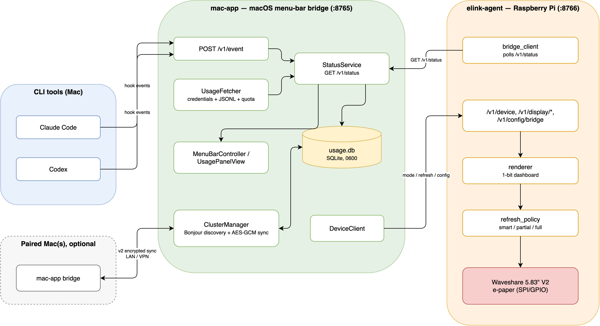
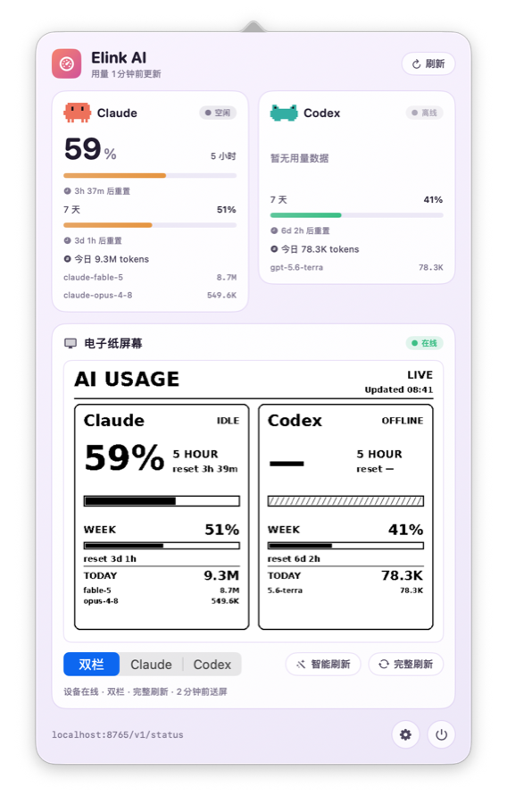
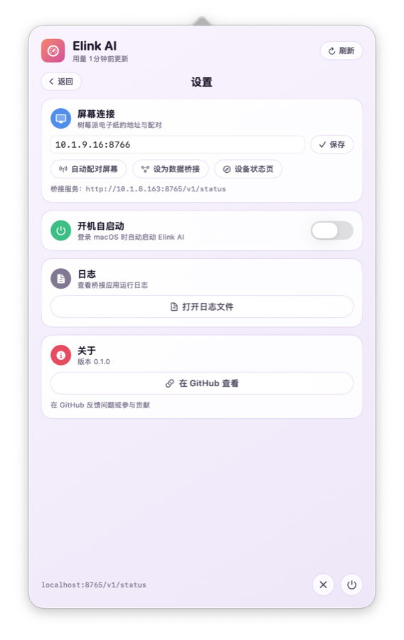
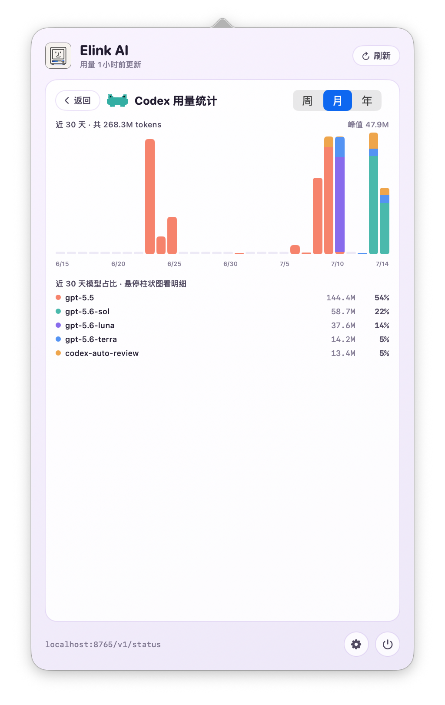

# elink-ai

`elink-ai` shows Claude Code and Codex activity and quota on a 648×480
Waveshare 5.83 inch V2 e-paper display.

It has two deliberately separate processes:

- `mac-app/`: a native macOS menu-bar bridge. It reads local CLI credentials
  and JSONL sessions, fetches quota, accepts CLI hooks, and serves sanitized
  status on port 8765.
- `elink-agent/`: a Raspberry Pi service. It polls the bridge, renders a 1-bit
  dashboard, applies refresh throttling, and drives the panel over SPI/GPIO.

OAuth tokens and raw session logs never leave the host.

## Architecture

<p>
  
</p>

The editable source is [docs/architecture.drawio](docs/architecture.drawio)
(open with [draw.io](https://app.diagrams.net)).

## Dashboard preview

<p>
  
</p>

## macOS menu-bar app

<p>
  
  
</p>

### Usage statistics

<p>
  
  
</p>

Each provider card opens stacked bar charts with day/week/month/year ranges.
The day range shows today's hour-by-hour token distribution (24 bars);
hovering a bar reveals the per-model breakdown for that hour, day, or month.
Every range can be filtered to one host and ends with a per-device share, each
host keeping its own colour across ranges and across machines. A
token-categories section splits the selected range into input, output, cache
read, cache write, and reasoning tokens with a proportion bar and per-category
percentages (collected locally from the day the feature is enabled).

## Current scope

- Claude and Codex side-by-side dashboard
- 5-hour and weekly usage/reset time
- today's total and per-model token count, plus working/idle/offline state
- hourly (today), daily, and monthly token usage charts with per-model breakdown
- token-category breakdown (input/output/cache read/cache write/reasoning) per range
- English and Chinese interface language, switchable in settings at runtime
- attention border for permission requests
- final full, and manual full refresh
- stale/offline display, last-frame preview, and persistent device settings
- device-monitor idle screen: when AI usage is idle the panel flips to a live
  page with a CPU hero card (load, usage, and a 30-sample trend) plus memory,
  disk, temperature, network and panel-health readings, and flips back the
  moment a session starts (configurable via the `[monitor]` section)
- menu-bar device discovery, DHCP/bridge self-healing, and detailed quota/reset status
- exact last-frame preview with page switching and smart/full refresh controls
- restart-safe quota caching with per-provider freshness and fallback status
- encrypted peer-to-peer usage aggregation across paired hosts on the same LAN/VPN
- manual and periodic GitHub Release checks with direct access to the newest DMG
- live Claude Code / Codex terminal-session list in the panel with running,
  idle, and finished states plus collapsible subagents

The LCD-specific pet animation, music, and network graphs from `esp8266-ai`
are intentionally excluded because they conflict with e-paper refresh limits.

## Develop the Pi agent without hardware

Python 3.11+ and Pillow are required.

```bash
python3 -m venv .venv
.venv/bin/pip install -e '.[test]'
cp install/config.example.toml /tmp/elink-ai.toml
# Change driver to "mock" and choose writable /tmp output/state paths.
.venv/bin/elink-agent --config /tmp/elink-ai.toml
```

The device API is then available at `http://localhost:8766/v1/device`, and the
last rendered image at `http://localhost:8766/v1/preview.png`.

Run tests with:

```bash
.venv/bin/pytest -q
```

## Run the macOS bridge

On macOS 13 or later with Xcode command-line tools:

```bash
cd mac-app
swift test
swift run ElinkAIBridge
```

The app runs only in the menu bar, showing a color-coded Claude usage
percentage next to the icon. Left-click opens a panel with Claude and Codex
usage cards (5-hour/weekly windows, reset countdowns, per-model tokens), a live
list of Claude Code / Codex sessions running in local terminals (animated pixel
mascot while busy, dimmed when idle, green check when finished, subagents in a
collapsible dropdown; discovered via `ps`/`lsof` and session transcripts, only
polled while the panel is open, and toggleable in settings), the exact PNG last
sent to the display with page switching and smart/full refresh controls, and a
settings page for device pairing, launch at login, interface language
(English/中文, follows the system language by default), logs, and about.
Settings are available from the gear button at the bottom of the panel.
Verify the bridge with:

```bash
curl -s http://localhost:8765/v1/status | python3 -m json.tool
```

### Keep Claude usage authentication independent of terminals

Claude Code credentials stored in its own Keychain can rotate or expire, and a
`CLAUDE_CODE_OAUTH_TOKEN` inherited by one terminal is not visible to the
menu-bar app. For stable background usage updates, run:

```bash
claude setup-token
```

Then open Elink Settings → Claude Authentication and paste the generated
long-lived token. Elink stores it only in the macOS login Keychain;
it is never written to settings or logs. Removing it from Elink restores
automatic Claude credential discovery and does not sign Claude Code out.

### Sync usage across hosts

Open Settings → Multi-Host Sync on the first host and create a sync cluster.
Choose “Add Host” to show a six-digit code, then enter that code and the first
host's address on another host. Bonjour discovers peers on a normal LAN; a manual
`host:8765` address also works when a VPN does not forward multicast discovery.
If both hosts accidentally created separate one-node clusters, use “Join Another
Cluster” on either host; entering all six digits submits pairing automatically
and keeps that host's local usage history.

Each host keeps the latest per-node daily/model snapshots, each carrying that
day's hour-by-hour distribution so the day range can also be split by host.
Hosts running an older version keep syncing; they simply contribute no hourly
detail, which is reported as unknown rather than as zero. The dashboard and
`/v1/status` return the cluster-wide sum, while quota windows use the freshest
observation because quota percentages are account-level values and must not be
added together. Pairing and sync never transfer OAuth credentials or raw logs.
The node identity and cluster secret are stored in the local
`~/Library/Application Support/ElinkAI/usage.db` SQLite database. The directory
uses owner-only (`0700`) permissions and the database uses `0600`; elink-ai does
not put cluster credentials in macOS Keychain.

Build an ad-hoc-signed menu-bar app bundle with:

```bash
cd mac-app
sh build-app.sh
open .build/ElinkAIBridge.app
```

Build an ad-hoc-signed DMG installer with:

```bash
cd mac-app
sh build-dmg.sh
open .build/elink-ai-v0.1.22.dmg
```

Pushing a `v*` tag runs the release workflow, creates the matching GitHub
Release when needed, and uploads the versioned macOS DMG plus Linux
`elink-tui` archives for `arm64` and `amd64`.

Before tagging a release, add a matching `## X.Y.Z` section to
[CHANGELOG.md](CHANGELOG.md). Keep its non-empty subsections in `Packaging`,
`Added`, `Changed`, `Fixed`, and `Removed` order; the workflow uses that section
as the GitHub Release body.

After copying it to `/Applications`, the example LaunchAgent in `install/` can
start it at login. Replace `YOUR-USERNAME` in its two log paths first: they must
stay under your own `~/Library/Logs`, because a fixed name in the shared `/tmp`
can be symlinked by any other local account before the agent opens it.

`install/anchor-claude-window.sh` keeps Claude's 5-hour usage window aligned
with your working day. The window starts at its own first message and expires
five hours later, so a stray morning question anchors the whole day's
boundaries at an arbitrary time. Scheduled by
`local.elink-ai-anchor.plist.example`, the script checks `five_hour.resets_at`
at the times you pick and sends one minimal message only when no window is
running, pinning the grid to 09:00 / 14:00 instead. Each anchor consumes a
five-hour block and unused quota does not carry over, so list only the
boundaries you actually work past.

Claude hooks can be merged without replacing existing settings:

```bash
python3 hooks/install-claude-hooks.py
```

The installer saves `~/.claude/settings.json.elink-ai.bak`. Codex hook schemas
are still evolving; the bridge endpoint supports Codex events, but this version
does not rewrite Codex configuration automatically. Log mtime detection remains
active for both providers.

### MCP server for coding CLIs

`mcp/elink-mcp.py` is a stdio MCP server (Python standard library only) that
lets Claude Code, Codex, and the Antigravity/Gemini CLI read the quota the
bridge already collects. It offers one tool, `get_usage_limits`, with an
optional `provider` (`claude`, `codex`, or `gemini`). Each provider returns a
`primary` window (five hours for Claude and Codex; five hours or a day for
Gemini) and a `weekly` window with `used_pct`, an approximate `resets_at`, and
`resets_in_min`, plus `scoped_limits`, `extra_usage`, `credit_balance`,
`data_age_s` (seconds since that provider's quota was fetched), and
`error`; unknown values are `null`, never zero. With Multi-Host Sync the
figures may come from another host's account. It returns quota only: no
token counts, costs, sessions, or project names. Register it with an absolute path:

```bash
claude mcp add -s user elink-ai -- python3 "$PWD/mcp/elink-mcp.py"
codex mcp add elink-ai -- python3 "$PWD/mcp/elink-mcp.py"
agy mcp add elink-ai python3 "$PWD/mcp/elink-mcp.py"
```

It reads `http://127.0.0.1:8765/v1/status`, so the mac-app (or `elink-tui` in
local mode) must be running; otherwise the tool call reports the bridge as
unreachable. Set `ELINK_BRIDGE_URL` to use a bridge on another host, e.g.
`claude mcp add -s user elink-ai -e ELINK_BRIDGE_URL=http://mac:8765 -- ...`
(the server name goes before `-e`).
Models call it when asked about remaining quota; to have an agent route work
by quota, say so in your `CLAUDE.md` or `AGENTS.md`. Interactive sessions ask
before the first call. Non-interactive runs deny it unless allowed in advance:
`--allowedTools mcp__elink-ai__get_usage_limits` for `claude -p`,
`default_tools_approval_mode = "approve"` under `[mcp_servers.elink-ai]` for
`codex exec`, and `mcp(elink-ai/get_usage_limits)` in `permissions.allow` for
`agy -p`.

## Linux terminal dashboard

`elink-tui/` is a keyboard-driven Rust TUI that mirrors the macOS dashboard in
a terminal: Claude and Codex cards with working/idle/offline state, today's
per-model tokens, and 5-hour/weekly quota bars with reset countdowns. It runs
in two modes:

- **local** (default): reads `~/.claude` and `~/.codex` on the Linux machine
  and fetches quota directly, with the same statusline-cache and session-log
  fallbacks as the macOS app. No mac-app bridge required.
- **remote**: polls an existing mac-app bridge over the LAN.

```bash
cd elink-tui
cargo build --release
./target/release/elink-tui                          # local mode
./target/release/elink-tui --bridge http://mac:8765 # remote mode
./target/release/elink-tui --once                   # print one JSON snapshot
./target/release/elink-tui --compact                # print one cached summary
```

Everything is keyboard-only: `q` quit, `r` refresh, `Tab`/`←`/`→` switch the
focused card, `1`/`2` jump to a card, `↑`/`↓` scroll the model list, `s` local
usage history, `d` device page, `u` update check, `m` toggle local/remote, `?`
help.
Optional settings live in `~/.config/elink-ai/tui.toml`:

```toml
mode = "local"                     # or "remote"
bridge_url = "http://mac:8765"

[refresh]
status_poll_s = 2
quota_fetch_s = 120

[paths]
usage_db = "~/.local/state/elink-ai/usage.db"

[hooks]
listen = "127.0.0.1:8765"          # "" disables the hook listener

[device]
url = "http://pi:8766"             # enables the e-paper device page
```

In local mode the TUI listens for the same `POST /v1/event` hook requests as
the mac-app bridge, so `python3 hooks/install-claude-hooks.py` gives it live
working/idle transitions and permission-request (`⚠ input`) alerts; without
hooks, state falls back to session-file timestamps. The last fetched quota is
cached in the private `~/.local/state/elink-ai/usage.db` SQLite store (`0600`)
so a restart shows usage bars immediately.

In local mode, pressing `s` opens a usage-history page with daily token charts
and per-model totals over the last week, month (`w`/`m`), or twelve months
(`y`). In a cluster, `n` cycles between all nodes and one node, while the
aggregate view shows per-node shares. History is backfilled from existing
session logs on first launch and kept in the same `usage.db`; remote mode does
not mix in this machine's local history.

The listener also serves the latest local snapshot on `GET /v1/status` in the
standard bridge format, so a Raspberry Pi agent (or another consumer) can use
a Linux machine as its data bridge — set `listen = "0.0.0.0:8765"` to expose
it beyond localhost, and only on a trusted LAN, matching the ports-8765/8766
security guidance below.

With `[device] url = "http://pi:8766"` configured, `d` opens a device page
showing the agent's status and the exact e-paper frame (rendered with
half-block characters), with keys for display mode (`1`/`2`/`3`), smart/full
refresh (`p`/`f`), and pointing the device at this machine's bridge (`b`).
The `b` action is enabled only while local mode has a fresh snapshot and a
successfully bound, non-loopback listener; otherwise the TUI explains why it
cannot advertise this machine to the device.
`u` checks GitHub for a newer release (falling back to an existing
`gh auth login` session for private repositories), and the terminal title
shows the worse weekly quota percentage — the menu-bar equivalent. For a
tmux status line or waybar module, `elink-tui --compact` prints a one-line
summary such as `C● 43%/68% | X○ 12%/22%` and exits.
Compact mode scans current local sessions and reads the persisted quota cache;
it does not contact provider APIs, start history backfill, or mutate history.

Run tests with:

```bash
cd elink-tui
cargo test
```

## Install on Raspberry Pi

First edit `install/config.example.toml` or edit the installed copy afterward,
especially `bridge_url`. Then:

```bash
sudo sh install/install-pi.sh
sudo editor /etc/elink-ai/config.toml
sudo systemctl restart elink-agent
journalctl -u elink-agent -f
```

The installer enables SPI and installs a root systemd service. It also enables
`elink-agent-update.timer`, which checks GitHub Releases 10 minutes after boot
and then every 6 hours. When a newer signed `elink-agent` package is available,
the timer installs it, restarts the agent, and rolls back if the new version
does not come up. A version that was rolled back is not retried until you delete
`/var/lib/elink-ai/update-failed`, and no update runs while `elink-agent` is
stopped. If the rollback cannot be confirmed either, the journal shows
`RollbackFailed` and nothing is recorded; recover by hand by re-running
`sudo sh install/install-pi.sh` from a checkout of the version you want, then
`sudo systemctl reset-failed elink-agent && sudo systemctl restart elink-agent`. For maintenance, first run
`sudo systemctl stop elink-agent-update.timer`, then wait until
`systemctl list-jobs elink-agent-update.service` shows no jobs and
`systemctl is-active elink-agent-update` no longer reports `activating` before
stopping `elink-agent`. Run `sudo systemctl start elink-agent-update` to check right away, and
`journalctl -u elink-agent-update` to see the result. While the
repository is private, put `GITHUB_TOKEN=<token with read access>` in
`/etc/elink-ai/update.env` (owner root, mode 0600). Start with the
mock driver if the exact panel revision or wiring is uncertain. Hardware wiring
and partial-refresh cautions are in [docs/hardware.md](docs/hardware.md).

## APIs and security

The versioned protocol is documented in [docs/protocol.md](docs/protocol.md).
Both services use unauthenticated HTTP and are intended only for a trusted LAN.
Do not expose ports 8765 or 8766 to the public internet.

## License and provenance

The project is GPL-3.0-only. The isolated Waveshare adapter follows the public
Waveshare 5.83 V2 command sequence and the GPL-licensed InkyPi integration.
The macOS implementation was rewritten for this repository around the observed
data flow; it does not include the ESP8266 firmware or its display assets.

See [PLAN.md](PLAN.md) for architecture decisions, rollout phases, risks, and
acceptance criteria.
