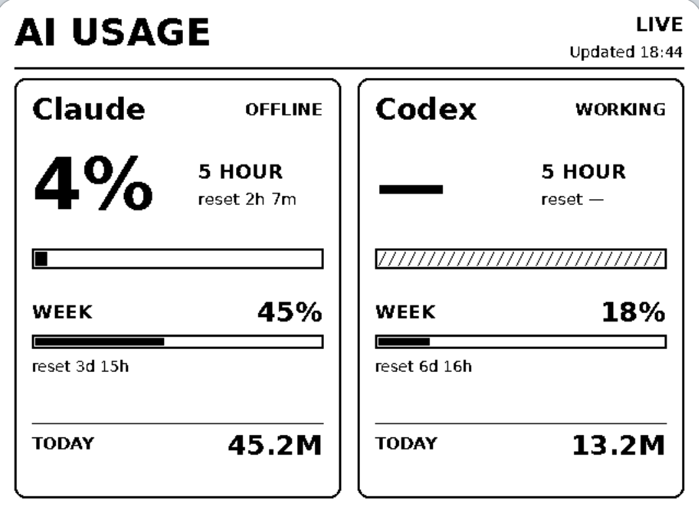
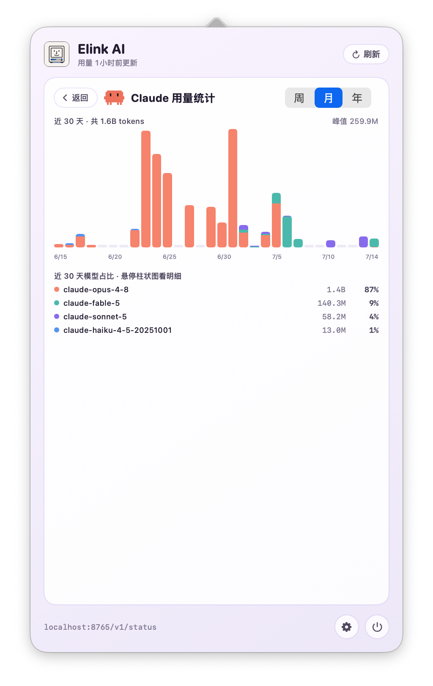

# elink-ai

`elink-ai` shows Claude Code and Codex activity and quota on a 648×480
Waveshare 5.83 inch V2 e-paper display.

It has two deliberately separate processes:

- `mac-app/`: a native macOS menu-bar bridge. It reads local CLI credentials
  and JSONL sessions, fetches quota, accepts CLI hooks, and serves sanitized
  status on port 8765.
- `elink-agent/`: a Raspberry Pi service. It polls the bridge, renders a 1-bit
  dashboard, applies refresh throttling, and drives the panel over SPI/GPIO.

OAuth tokens and raw session logs never leave the Mac.

## Architecture

<p>
  
</p>

The editable source is [docs/architecture.drawio](docs/architecture.drawio)
(open with [draw.io](https://app.diagrams.net)).

## Dashboard preview

<p>
  
</p>

## macOS menu-bar app

<p>
  
  
</p>

### Usage statistics

<p>
  
  
</p>

## Current scope

- Claude and Codex side-by-side dashboard
- 5-hour and weekly usage/reset time
- today's total and per-model token count, plus working/idle/offline state
- attention border for permission requests
- smart, partial, periodic full, and manual full refresh
- stale/offline display, last-frame preview, and persistent device settings
- menu-bar device discovery, DHCP/bridge self-healing, and detailed quota/reset status
- exact last-frame preview with page switching and smart/full refresh controls
- restart-safe quota caching with per-provider freshness and fallback status
- encrypted peer-to-peer usage aggregation across paired Macs on the same LAN/VPN
- manual and periodic GitHub Release checks with direct access to the newest DMG

The LCD-specific pet animation, music, and network graphs from `esp8266-ai`
are intentionally excluded because they conflict with e-paper refresh limits.

## Develop the Pi agent without hardware

Python 3.11+ and Pillow are required.

```bash
python3 -m venv .venv
.venv/bin/pip install -e '.[test]'
cp install/config.example.toml /tmp/elink-ai.toml
# Change driver to "mock" and choose writable /tmp output/state paths.
.venv/bin/elink-agent --config /tmp/elink-ai.toml
```

The device API is then available at `http://localhost:8766/v1/device`, and the
last rendered image at `http://localhost:8766/v1/preview.png`.

Run tests with:

```bash
.venv/bin/pytest -q
```

## Run the macOS bridge

On macOS 13 or later with Xcode command-line tools:

```bash
cd mac-app
swift test
swift run ElinkAIBridge
```

The app runs only in the menu bar, showing a color-coded Claude usage
percentage next to the icon. Left-click opens a panel with Claude and Codex
usage cards (5-hour/weekly windows, reset countdowns, per-model tokens), the
exact PNG last sent to the display with page switching and smart/full refresh
controls, and a settings page for device pairing, launch at login, logs, and
about. Settings are available from the gear button at the bottom of the panel.
Verify the bridge with:

```bash
curl -s http://localhost:8765/v1/status | python3 -m json.tool
```

### Sync usage across Macs

Open Settings → Multi-Mac Sync on the first Mac and create a sync cluster.
Choose “Add Mac” to show a six-digit code, then enter that code and the first
Mac's address on another Mac. Bonjour discovers peers on a normal LAN; a manual
`host:8765` address also works when a VPN does not forward multicast discovery.
If both Macs accidentally created separate one-node clusters, use “Join Another
Cluster” on either Mac; entering all six digits submits pairing automatically
and keeps that Mac's local usage history.

Each Mac keeps the latest per-node daily/model snapshots. The dashboard and
`/v1/status` return the cluster-wide sum, while quota windows use the freshest
observation because quota percentages are account-level values and must not be
added together. Pairing and sync never transfer OAuth credentials or raw logs.
The node identity and cluster secret are stored in the local
`~/Library/Application Support/ElinkAI/usage.db` SQLite database. The directory
uses owner-only (`0700`) permissions and the database uses `0600`; elink-ai does
not put cluster credentials in macOS Keychain.

Build an ad-hoc-signed menu-bar app bundle with:

```bash
cd mac-app
sh build-app.sh
open .build/ElinkAIBridge.app
```

Build an ad-hoc-signed DMG installer with:

```bash
cd mac-app
sh build-dmg.sh
open .build/elink-ai-v0.1.12.dmg
```

Pushing a `v*` tag runs the release workflow, creates the matching GitHub
Release when needed, and uploads a versioned asset such as
`elink-ai-v0.1.12.dmg`.

Before tagging a release, add a matching `## X.Y.Z` section to
[CHANGELOG.md](CHANGELOG.md). Keep its non-empty subsections in `Packaging`,
`Added`, `Changed`, `Fixed`, and `Removed` order; the workflow uses that section
as the GitHub Release body.

After copying it to `/Applications`, the example LaunchAgent in `install/` can
start it at login.

Claude hooks can be merged without replacing existing settings:

```bash
python3 hooks/install-claude-hooks.py
```

The installer saves `~/.claude/settings.json.elink-ai.bak`. Codex hook schemas
are still evolving; the bridge endpoint supports Codex events, but this version
does not rewrite Codex configuration automatically. Log mtime detection remains
active for both providers.

## Install on Raspberry Pi

First edit `install/config.example.toml` or edit the installed copy afterward,
especially `bridge_url`. Then:

```bash
sudo sh install/install-pi.sh
sudo editor /etc/elink-ai/config.toml
sudo systemctl restart elink-agent
journalctl -u elink-agent -f
```

The installer enables SPI and installs a root systemd service. Start with the
mock driver if the exact panel revision or wiring is uncertain. Hardware wiring
and partial-refresh cautions are in [docs/hardware.md](docs/hardware.md).

## APIs and security

The versioned protocol is documented in [docs/protocol.md](docs/protocol.md).
Both services use unauthenticated HTTP and are intended only for a trusted LAN.
Do not expose ports 8765 or 8766 to the public internet.

## License and provenance

The project is GPL-3.0-only. The isolated Waveshare adapter follows the public
Waveshare 5.83 V2 command sequence and the GPL-licensed InkyPi integration.
The macOS implementation was rewritten for this repository around the observed
data flow; it does not include the ESP8266 firmware or its display assets.

See [PLAN.md](PLAN.md) for architecture decisions, rollout phases, risks, and
acceptance criteria.
